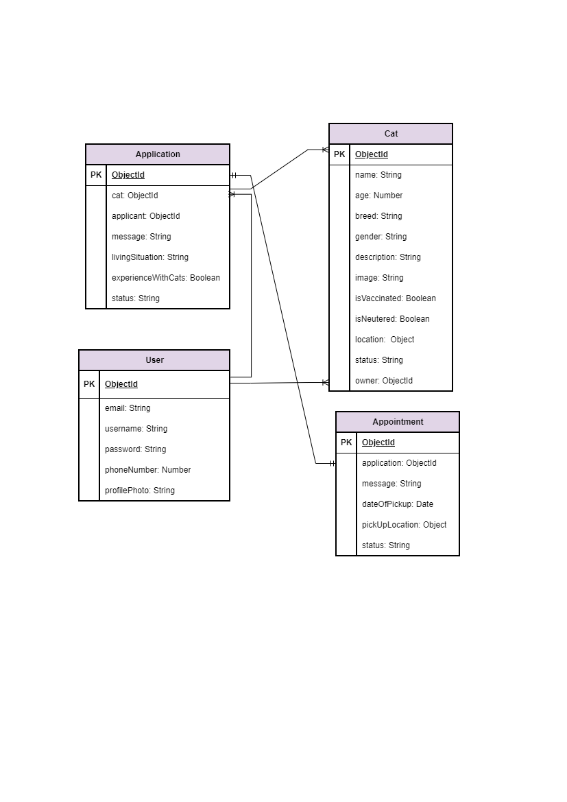

# Project Name

## Overview

## Screenshots

## Technologies Used

## Getting Started

## User Stories

1. As a user, I want to be able to create an account, login and logout of the website.

2. As a user, I want to be able to list a cat for adoption so that intrested people can find and adopt it.

3. As a user, I want to be able to browse and filter avaialble cats so that I can find a cat that matches my prefrence.

4. As a user, I want to view detailed information about avaialbe cats so that I can decide whther to apply for adoption or not.

5. As a user, I want to view, edit, and delete my cat listings so that I can manage them.

6. As a user, I want to be able to submit an adoption application with my information and experience so that I can express my intrest in adopting a cat.

7. As a cat owner, I want to view the adoption applications and approve or reject applications.

8. As a user, I want to view the adoption applications I have submitted and their statuses so that I can track my applications.

9. As a cat owner, I want to schedule appointments with approved applicants so that we can arrange a meeting.

10. As a cat owner, I want to be able to change the status of the cat from availble to adopted. 

10. As a user, I want to view and manage my appointments so that I can keep track of upcoming and completed meetings.

11. As a visitor, I want to view featured cats on the homepage so that I can discover cats available for adoption.

## Database Design

## Routes

| Method | Route | Description |
|---------|-------|-------------|
| GET | / | Home page |
| GET | /listings | List all listings |
| GET | /listings/new | New listing form |
| POST | /listings | Create listing |
| GET | /listings/:id | View listing |
| GET | /listings/:id/edit | Edit listing form |
| PUT | /listings/:id | Update listing |
| DELETE | /listings/:id | Delete listing |

## Features

## Future Enhancements

## Credits and Refrences

- [MDN Web Docs – JavaScript Date Object](https://developer.mozilla.org/en-US/docs/Web/JavaScript/Reference/Global_Objects/Date)
- [MDN – Representing Dates & Times](https://developer.mozilla.org/en-US/docs/Web/JavaScript/Guide/Representing_dates_times)
- [MDN – Date.prototype.getTime()](https://developer.mozilla.org/en-US/docs/Web/JavaScript/Reference/Global_Objects/Date/getTime)
- [MDN – Date.prototype.setDate()](https://developer.mozilla.org/en-US/docs/Web/JavaScript/Reference/Global_Objects/Date/setDate)
- [MDN – Date.prototype.setHours()](https://developer.mozilla.org/en-US/docs/Web/JavaScript/Reference/Global_Objects/Date/setHours)
- [MDN – Date.prototype.toLocaleDateString()](https://developer.mozilla.org/en-US/docs/Web/JavaScript/Reference/Global_Objects/Date/toLocaleDateString)
- [MDN – Date.prototype.toLocaleTimeString()](https://developer.mozilla.org/en-US/docs/Web/JavaScript/Reference/Global_Objects/Date/toLocaleTimeString)
- [Learn JavaScript DATE Objects in 8 Minutes!](https://www.youtube.com/watch?v=LwYwz67l1lA)
- [Event: preventDefault() method](https://developer.mozilla.org/en-US/docs/Web/API/Event/preventDefault)