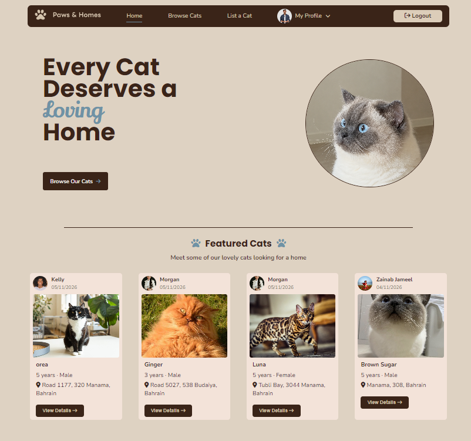
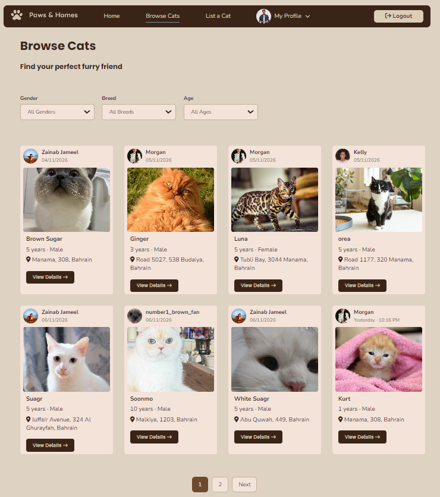
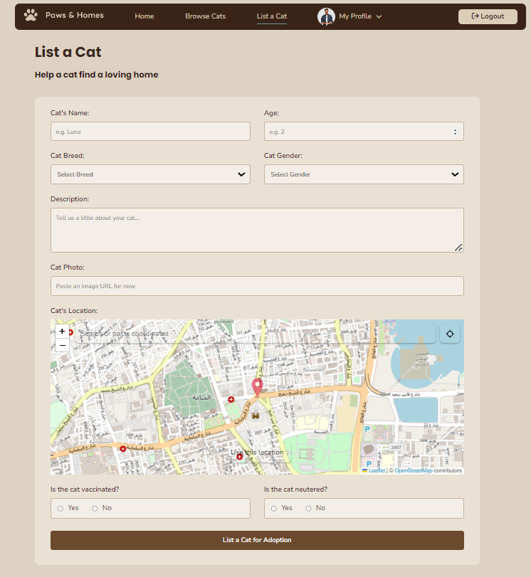

# Paws & Homes

## Overview

Paws & Homes is a cat adoption website that connects cat owners with potential adopters. Users can list cats for adoption, browse available cats, submit adoption applications, manage requests, and schedule pickup appointments. The platform aims to make finding loving homes for cats simple and convenient.

## Screenshots

## Technologies Used

### Frontend
- EJS
- CSS3
- JavaScript

### Backend
- Node.js
- Express.js

### Database
- MongoDB
- Mongoose

### Tools & Libraries
- Cloudinary
- Location picker on Github
- Express Validator
- Express Session
- Bcrypt
- SweetAlert2
- Git & GitHub

## Getting Started

## User Stories

1. As a user, I want to be able to create an account, login and logout of the website.

2. As a user, I want to be able to list a cat for adoption so that intrested people can find and adopt it.

3. As a user, I want to be able to browse and filter avaialble cats so that I can find a cat that matches my prefrence.

4. As a user, I want to view detailed information about avaialbe cats so that I can decide whther to apply for adoption or not.

5. As a user, I want to view, edit, and delete my cat listings so that I can manage them.

6. As a user, I want to be able to submit an adoption application with my information and experience so that I can express my intrest in adopting a cat.

7. As a cat owner, I want to view the adoption applications and approve or reject applications.

8. As a user, I want to view the adoption applications I have submitted and their statuses so that I can track my applications.

9. As a cat owner, I want to schedule appointments with approved applicants so that we can arrange a meeting.

10. As a cat owner, I want to be able to change the status of the cat from availble to adopted. 

10. As a user, I want to view and manage my appointments so that I can keep track of upcoming and completed meetings.

11. As a visitor, I want to view featured cats on the homepage so that I can discover cats available for adoption.

## Database Design

## Routes

 ### Cat Routes 

| Method 	| Route                    	| Descreption                                                                    	|
|--------	|--------------------------	|--------------------------------------------------------------------------------	|
| GET    	| /cat/new                 	| Displays the form to list a new cat.                                           	|
| POST   	| /cat                     	| Creates a new cat listing and save it in the database                          	|
| GET    	| /cat                     	| Displays available cats in the browse cats page with filtering and pagination. 	|
| GET    	| /cat/:catId              	| Displays the details of a specific cat.                                        	|
| GET    	| /cat/:userId/my-listings 	| Displays all cat listings created by the logged-in user.                       	|
| DELETE 	| /cat/:catId/delete       	| Deletes a specific cat listing.                                                	|
| GET    	| /cat/:catId/edit         	| Displays the form to edit a cat listing.                                       	|
| PUT    	| /cat/:catId              	| Updates an existing cat listing.                                               	|
| POST   	| /cat/:catId/adopt        	| Change the cat status to Adopted                                               	|

### Application Routes

| Method 	| Route                                               	| Descreption                                                                  	|
|--------	|-----------------------------------------------------	|------------------------------------------------------------------------------	|
| GET    	| application/cat/:catId/new                          	| Displays the adoption application form for a specific cat.                   	|
| POST   	| application/cat/:catId                              	| Checks for existing applications and submits a new adoption application.     	|
| GET    	| application                                         	| Displays all adoption applications submitted by the logged-in user.          	|
| GET    	| application/application-requests                    	| Displays all adoption requests received for the user's listed cats.          	|
| GET    	| application/:applicationId                          	| Displays the details of an application that the logged-in user has submitted 	|
| GET    	| application/:applicationId/view-application-request 	| Displays the details of a specific adoption request.                         	|
| POST   	| application/:applicationId/accept                   	| Updates the application status to Accepted.                                  	|
| POST   	| application/:application/reject                     	| Updates the application status to Rejected.                                  	|

### Appointment Routes

| Method 	| Route                                 	| Descreption                                                                                             	|
|--------	|---------------------------------------	|---------------------------------------------------------------------------------------------------------	|
| GET    	| /appointment/new/:applicationId       	| Displays the form to schedule an adoption appointment for a specific application.                       	|
| POST   	| /appointment/:applicationId           	| Creates a new appointment with the pickup date, location, and message.                                  	|
| GET    	| /appointment                          	| Displays all appointments related to the logged-in user's adoption applications, sorted by pickup date. 	|
| GET    	| /appointment/:appointmentId           	| Displays the details of a specific appointment.                                                         	|
| POST   	| /appointment/:appointmentId/complete  	| Marks an appointment as completed after verifying that the logged-in user is the applicant.             	|
| POST   	| /appointment/:appointmentId/cancelled 	| Cancels an appointment after verifying that the logged-in user is the applicant.                        	|

## Features
- User authentication
- Create, edit, and delete cat listings
- Browse available cats
- Filter cats by gender, breed, and age
- View detailed cat profiles and photos
- Submit and manage adoption applications
- Accept or reject adoption requests
- Schedule adoption pickup appointments
- Track application and appointment statuses

## Future Enhancements
- Add keyword-based search functionality
- Add user roles of admin and normal user
- Introduce an in-app messaging system between adopters and cat owners
- Add email notifications for application and appointment updates
- Expand user profile management features

## Credits and Refrences

- [MDN Web Docs – JavaScript Date Object](https://developer.mozilla.org/en-US/docs/Web/JavaScript/Reference/Global_Objects/Date)
- [MDN – Representing Dates & Times](https://developer.mozilla.org/en-US/docs/Web/JavaScript/Guide/Representing_dates_times)
- [MDN – Date.prototype.getTime()](https://developer.mozilla.org/en-US/docs/Web/JavaScript/Reference/Global_Objects/Date/getTime)
- [MDN – Date.prototype.setDate()](https://developer.mozilla.org/en-US/docs/Web/JavaScript/Reference/Global_Objects/Date/setDate)
- [MDN – Date.prototype.setHours()](https://developer.mozilla.org/en-US/docs/Web/JavaScript/Reference/Global_Objects/Date/setHours)
- [MDN – Date.prototype.toLocaleDateString()](https://developer.mozilla.org/en-US/docs/Web/JavaScript/Reference/Global_Objects/Date/toLocaleDateString)
- [MDN – Date.prototype.toLocaleTimeString()](https://developer.mozilla.org/en-US/docs/Web/JavaScript/Reference/Global_Objects/Date/toLocaleTimeString)
- [Learn JavaScript DATE Objects in 8 Minutes!](https://www.youtube.com/watch?v=LwYwz67l1lA)
- [Event: preventDefault() method](https://developer.mozilla.org/en-US/docs/Web/API/Event/preventDefault)
- [Sweet Alert Library](https://sweetalert2.github.io/)
- [location-picker](https://github.com/cyphercodes/location-picker)
- [Font Awesome Icons](https://fontawesome.com/v4/icons/)
- [The New dialog HTML Element Changes Modals Forever](https://www.youtube.com/watch?v=ywtkJkxJsdg)
- [histroy.back() method](https://www.w3schools.com/jsref/met_his_back.asp)
- [Master API Pagination: Implementing skip() and limit() in Express](https://www.youtube.com/watch?v=bZ_-v0MDMaY)
- [Adding Pagination in Node.js | Efficient Data Handling](https://www.youtube.com/watch?v=oKPA0lLyL_8&t=17s)